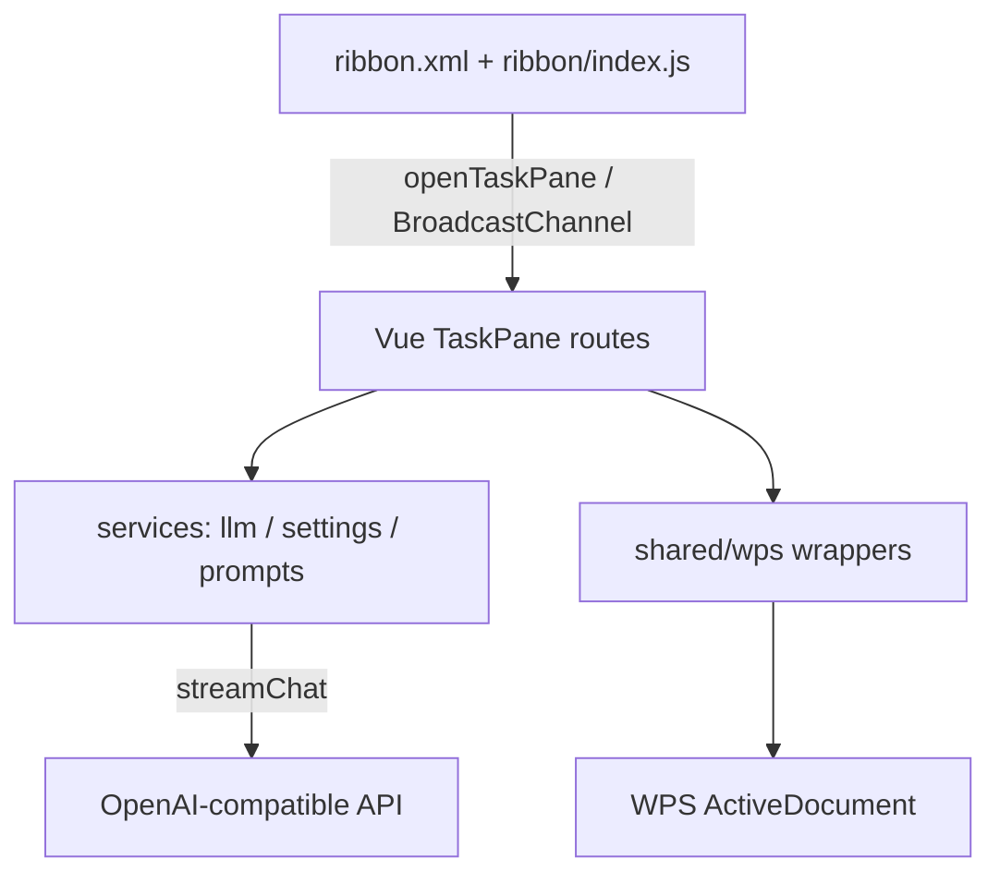

# Architecture

High-level flow of the **AI智写** WPS Office add-in (`wps-copilot-plugin`).

## Entry points

| Surface | Path | Role |
| --- | --- | --- |
| Ribbon callbacks | `src/main.js` → `window.ribbon` | WPS loads `ribbon.xml` actions |
| Ribbon dispatch | `src/ribbon/index.js` | Maps control IDs to chat / polish / settings / toolbox |
| Vue app | `src/App.vue` + `src/router/index.js` | Hash routes for task panes |
| Task pane URL | `shared/wps/util.js` `GetUrlPath()` + `GetRouterHash()` | Builds hosted URL for `CreateTaskPane` |

## Cross-cutting services

- **`settingsService`** — LLM URL / API key / model stored in `wps_copilot_settings.json` (also migrates a legacy settings filename until 2.0)
- **`llmService`** — `streamChat` / `stopGeneration`; in Vite DEV, rewrites cross-origin URLs through `/llm-proxy`
- **`promptService`** — `resolvePrompt(code)` from `src/config/prompts/prompts.json` (edit `domains/*.json` then `npm run extract-prompts`)

## Feature modules

| Feature | UI | Notes |
| --- | --- | --- |
| Free / scene writing | `features/chat`, `features/writing` | Chat pane; writing cards open chat via channel |
| Polish / proofread | `features/polish` | Prompts from `config/prompts`; tips from `polishPrompts.js` |
| Formatting | `features/formatting` | Templates + preview |
| Mind map | `features/mindmap` | Persists under `PluginStorage` key `mindmap_<docId>` |
| Settings | `features/settings` | Model configuration UI |
| Toolbox | `shared/wps/toolbox/*` | Ribbon one-shot utilities |

## Important PluginStorage / local keys

| Key | Purpose |
| --- | --- |
| `wps_copilot_settings.json` | Settings file name (FileSystem / localStorage) |
| `all_taskpanes` | Open task pane IDs |
| `wps-copilot-polish-history` | Polish pane chat history |
| `mindmap_<docId>` | Mind map JSON per document |
| BroadcastChannel `wps` | Cross-pane messages (`messageUtil.js`) |

## Security notes

- Treat LLM output as untrusted: Markdown paths use DOMPurify (`shared/markdown/createMarkdownRenderer.js`)
- Dev LLM proxy must stay on localhost / trusted LAN — see `SECURITY.md`
- Do not redistribute commercial fonts; users install locally

## Related docs

- [prompts/README.md](./prompts/README.md) — prompt contribution workflow
